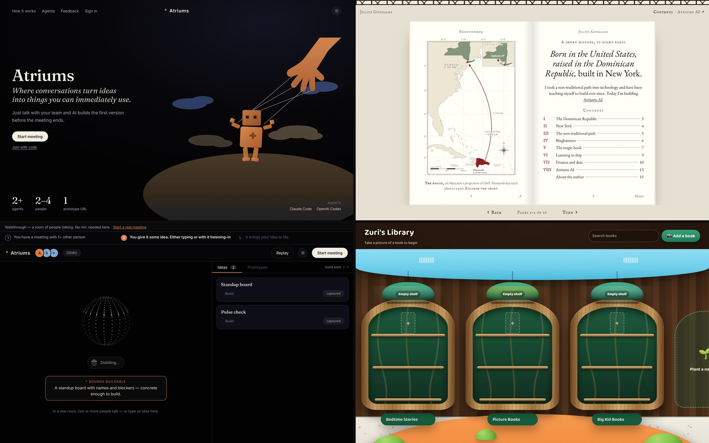

<h3>Hey, I'm Julius. Nice to meet you.</h3>

  

<b>Above:</b> <a href="https://www.atriums.ai/">Atriums AI</a> · <a href="https://github.com/watthell234/julius">my storybook site</a> · an Atriums room building ideas live · <a href="https://github.com/watthell234/BiblioZuri">BiblioZuri</a>

Born in the US, raised in the Dominican Republic, built in New York. I took the long way into tech and have been teaching myself to build ever since.

<table>
<tr><td><b>I</b></td><td>Eleven years growing up in the Dominican Republic, then New York City.</td></tr>
<tr><td><b>II</b></td><td>Community college, then Binghamton University, where I fell for startups.</td></tr>
<tr><td><b>III</b></td><td>My first startup was an AR magic book. Two school districts were ready to go, then our CTO quit, so I taught myself to code.</td></tr>
<tr><td><b>IV</b></td><td>Ten years in product and data at Avero and Jefferies, where I helped launch the firm's first LLM-powered application.</td></tr>
<tr><td><b>V</b></td><td>Now building <a href="https://www.atriums.ai/"><b>Atriums AI</b></a>: just talk with your team, and AI builds the first version before the meeting ends.</td></tr>
</table>

<table>
<tr><td><b>languages</b></td><td>    </td></tr>
<tr><td><b>frontend</b></td><td>    </td></tr>
<tr><td><b>agents / ai</b></td><td>    </td></tr>
<tr><td><b>data</b></td><td>    </td></tr>
<tr><td><b>infra</b></td><td>     </td></tr>
</table>
